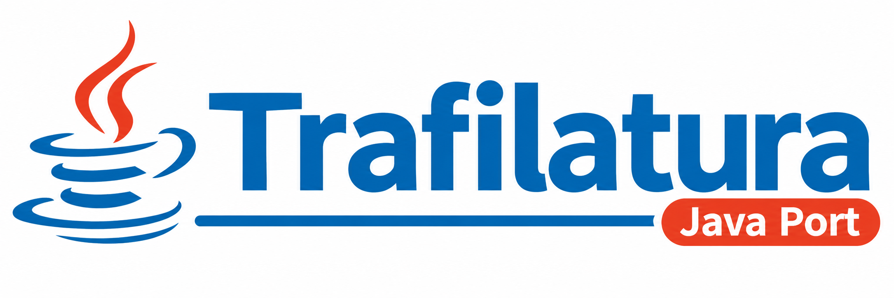
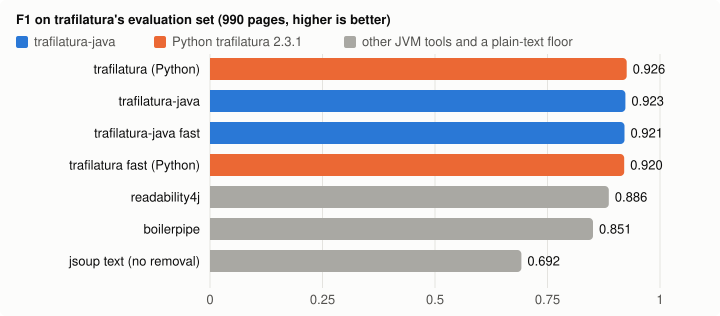

<p align="center">
  
</p>

# trafilatura-java

[](https://github.com/danielonet/trafilatura-java/actions/workflows/build.yml)
[](https://openjdk.org/projects/jdk/21/)
[](https://central.sonatype.com/artifact/io.github.danielonet/trafilatura-java)
[](https://codecov.io/gh/danielonet/trafilatura-java)
[](https://github.com/danielonet/trafilatura-java/releases)
[](LICENSE)

Extract the main text, comments and metadata from web pages in Java: a port of
[trafilatura](https://github.com/adbar/trafilatura) 2.3.1, the Python library by
[Adrien Barbaresi](https://github.com/adbar).

```java
import io.github.danielonet.trafilatura.Core;
import io.github.danielonet.trafilatura.Downloads;

String html = Downloads.fetch_url("https://peps.python.org/pep-0020/");
String markdown = Core.extract(html, Core.kw().output_format("markdown"));
System.out.println(markdown);
```

Output (shortened), with the site navigation, sidebar and footer removed:

````markdown
# PEP 20 – The Zen of Python

...

## Abstract

Long time Pythoneer Tim Peters succinctly channels the BDFL’s guiding principles for Python’s design into 20 aphorisms, only 19 of which have been written down.

## The Zen of Python

```
Beautiful is better than ugly.
Explicit is better than implicit.
...
```
````

**Why:** the usual JVM choice, boilerpipe, is no longer maintained, so JVM teams end up
calling Python trafilatura through a subprocess or a sidecar service. This library
runs in the same process, with the same algorithm and the same `settings.cfg`.

> **Status (v0.1.2)**
>
> - **Fidelity:** follows trafilatura 2.3.1 module by module. The library and the CLI
>   are fully ported.
> - **Tests:** 13 of the upstream pytest modules are ported and pass, 4,194 tests in
>   all: baseline, CLI, deduplication, downloads, feeds, filters, JSON metadata,
>   metadata, repeated output, sitemaps, spider, unit and XML/TEI. 11 tests are tagged
>   as known deviations (causes below) and 2 need network access; both groups are
>   skipped by default. The real-world tests and the evaluation scripts are not
>   ported yet.
> - **Known gaps:** courlan and htmldate are simplified, jusText is a stub (its
>   fallback never fires), there is no language detection, and HTML is parsed with
>   jsoup instead of libxml2. See [Differences from the Python version](#differences-from-the-python-version).

It returns the text as plain text, Markdown, XML, XML-TEI, JSON, CSV or simplified
HTML, optionally with title, author, date, site name, categories, tags and license.
It also covers the surrounding tooling: downloading pages, finding feeds and
sitemaps, and a small focused crawler.

## Benchmark

On trafilatura's own 990-page evaluation set, scored with upstream's evaluation code,
trafilatura-java matches Python trafilatura's accuracy to within 0.003 F1 and runs 1.3×
faster on one thread (1.5× on older hardware). It is more accurate than the extractors
already on the JVM.



| Tool | Precision | Recall | F1 | Pages/s, 1 thread (EPYC / 2012 laptop) |
| --- | --- | --- | --- | --- |
| Python trafilatura 2.3.1 | 0.907 | 0.946 | 0.926 | 42.8 / 19.3 |
| **trafilatura-java** | 0.908 | 0.939 | **0.923** | **55.1 / 29.8** |
| **trafilatura-java**, `fast` | 0.909 | 0.934 | **0.921** | **62.7 / 32.5** |
| Readability4J 1.0.8 | 0.868 | 0.905 | 0.886 | 113.5 / 57.3 |
| boilerpipe 1.2.3 | 0.846 | 0.856 | 0.851 | 223.3 / 102.5 |

Speeds were measured on a GitHub Actions runner (AMD EPYC 9V74) and on a 2012 laptop
(Intel i5-3317U); the accuracy is identical on both. In `fast` mode, 96.4% of pages give byte-identical output in Java and Python. Method, all
modes, multi-threaded throughput, memory and the pages where the two differ:
[benchmark/BENCHMARK.md](benchmark/BENCHMARK.md). Rerun it with `benchmark/run.sh`.

## Installation

Maven:

```xml
<dependency>
    <groupId>io.github.danielonet</groupId>
    <artifactId>trafilatura-java</artifactId>
    <version>0.1.2</version>
</dependency>
```

Gradle:

```groovy
implementation 'io.github.danielonet:trafilatura-java:0.1.2'
```

Command line: download `trafilatura-java-0.1.2-cli.jar` from the
[releases page](https://github.com/danielonet/trafilatura-java/releases) and run it with
`java -jar` (JDK 21+).

The library logs through SLF4J; add the binding your application already uses.

## Usage

### As a library

Function and field names stay the same as in Python (`bare_extraction`,
`extract_metadata`, `max_tree_size`...), so the
[trafilatura documentation](https://trafilatura.readthedocs.io/) applies, and the
Python source can be read side by side with this code.

```java
import io.github.danielonet.trafilatura.Core;
import io.github.danielonet.trafilatura.Downloads;
import io.github.danielonet.trafilatura.Metadata;
import io.github.danielonet.trafilatura.Settings.Document;

String html = Downloads.fetch_url("https://example.org/article");

// plain text, default settings
String text = Core.extract(html);

// Python keyword arguments are passed through a small builder
String xml = Core.extract(html, Core.kw()
        .output_format("xml")
        .with_metadata(true)
        .include_links(true));

// structured result instead of a string
Document doc = Core.bare_extraction(html, Core.kw().favor_precision(true));
System.out.println(doc.title + " / " + doc.date + "\n" + doc.text);

// metadata only
Document meta = Metadata.extract_metadata(html);
```

`TrafilaturaInit` re-exports the main entry points, like the Python package's
`__init__.py`.

### Command line

```bash
java -jar trafilatura-java-0.1.2-cli.jar --version
java -jar trafilatura-java-0.1.2-cli.jar -u https://example.org/article --markdown
cat page.html | java -jar trafilatura-java-0.1.2-cli.jar --json --with-metadata
```

The options are the same as the Python CLI; run with `--help` for the list.

### Configuration

Defaults come from `settings.cfg`, the same file as the Python version. Use your own
file with `Settings.use_config("my.cfg")`, then `Core.kw().config(...)`, or with
`--config-file` on the command line. Values not set in your file keep their defaults.

### Thread safety

`extract`, `bare_extraction` and `fetch_url` are safe to call from several threads at
once. Each call builds its own document tree, and the shared state (compiled XPath
expressions, the HTTP client, the deduplication cache) is either immutable or
synchronized. `ConcurrencyTests` checks that concurrent calls return the same output as
sequential ones.

Two things are shared on purpose, as in Python:

- With `deduplicate(true)`, all calls share one cache (`Deduplication.LRU_TEST`), so a
  paragraph seen by one thread counts as a duplicate in another. To keep it per
  document or per tenant, pass your own `new Deduplication.LRUCache(4096)` instead of
  `true`.
- The public static hooks (`Downloads.SEND_REQUEST`, `Settings.USE_CONFIG_HOOK`, the
  `SLEEP` hooks...) exist for tests. Don't reassign them while extractions are running.

## Differences from the Python version

## Differences from the Python version

- **Dependencies replaced by stand-ins.** courlan is ported in simplified form:
  URL query cleaning removes common tracking parameters and supports strict parameter
  allowlisting and language-parameter validation. Punycode decoding, public-suffix-list support,
  and URL language heuristics remain unsupported. htmldate only reads meta tags, JSON-LD, `<title>` elements and the URL.
  jusText is a stub, so its fallback never fires. Expect differences in dates, domains and some borderline extractions.
- **HTML parsing.** HTML is parsed with jsoup (HTML5 rules) instead of libxml2, so tree
  shapes can differ on malformed markup.
- **Optional Python extras are absent.** Language detection (py3langid), pycurl,
  brotli, zstd and SOCKS proxies are not available, as if they weren't installed in
  Python.
- **XPath attribute unions.** In `@id|@class`, Jaxen orders attributes by name, while
  lxml uses their order in the source.

The tests that fail because of these differences are tagged `known-deviation`; run
them with `./gradlew test -PallTests` or `./mvnw test -Dsurefire.excludedGroups=`.

## Building from source

JDK 21 or newer is all you need: `./mvnw` and `./gradlew` download Maven or Gradle
themselves.

```bash
./mvnw package       # compile, test, and build the library jar and target/*-cli.jar
./gradlew build      # the same with Gradle, jars under build/libs/
```

Dependencies, all fetched by the build: jsoup (HTML parsing), Jaxen (XPath), Jackson
(JSON), SLF4J (logging), juniversalchardet (charset detection), BouncyCastle (BLAKE2b
hashes), JUnit 5 (tests).

### Project layout

```
src/main/java/io/github/danielonet/trafilatura/
  *.java         the port itself: one class per Python module
                 (core.py -> Core, main_extractor.py -> MainExtractor, ...)
  lxml/          a small lxml-compatible element tree (text/tail model, live iteration,
                 XPath 1.0 via Jaxen, tostring, HTML parsing via jsoup)
  compat/        Python semantics with no direct Java equivalent: truthiness, str methods,
                 re module, json, configparser, argparse, difflib, robotparser, tuples
  courlan/       stand-in for the Python courlan package (URL handling)
  htmldate/      minimal stand-in for htmldate (publication dates)
  justext/       stub for jusText (fallback extractor)
src/main/resources/io/github/danielonet/trafilatura/   settings.cfg, TEI DTD
src/test/java/io/github/danielonet/trafilatura/tests/  ported pytest suites (JUnit 5)
src/test/java/io/github/danielonet/trafilatura/docs/   documentation build test (skipped without Sphinx)
src/test/resources/   test pages, cached real-world pages
```

## Contributing

Bug reports with the URL of a page that extracts badly are the most useful
contribution. To work on the code, read [CONTRIBUTING.md](CONTRIBUTING.md) first: the
port follows the Python source closely, and it lists the conventions that keep it that
way. Questions go to [Discussions](https://github.com/danielonet/trafilatura-java/discussions).

## Credits and citation

The algorithm, the heuristics, the settings and the test suites are the work of
Adrien Barbaresi and the [trafilatura contributors](https://github.com/adbar/trafilatura/graphs/contributors);
this project only carries them over to the JVM. The port started from a machine
translation (Pyrite) and was then rewritten by hand to compile and to behave like the
Python original.

If you use it in research, cite the trafilatura paper,
[Barbaresi (2021), ACL System Demonstrations](https://aclanthology.org/2021.acl-demo.15/):

```bibtex
@inproceedings{barbaresi-2021-trafilatura,
  title     = {Trafilatura: A Web Scraping Library and Command-Line Tool for Text Discovery and Extraction},
  author    = {Barbaresi, Adrien},
  booktitle = {Proceedings of the 59th Annual Meeting of the Association for Computational Linguistics and the 11th International Joint Conference on Natural Language Processing: System Demonstrations},
  pages     = {122--131},
  publisher = {Association for Computational Linguistics},
  year      = {2021},
  doi       = {10.18653/v1/2021.acl-demo.15}
}
```

## License

Apache License 2.0, the same as upstream trafilatura. See [LICENSE](LICENSE) and
[NOTICE](NOTICE).

The port is derived from trafilatura, courlan and htmldate (Apache-2.0, Adrien
Barbaresi). The jusText stand-in follows the API of jusText (BSD-2-Clause, see
[licenses/LICENSE-jusText.txt](licenses/LICENSE-jusText.txt)). The jar ships these
files under `META-INF/`.
